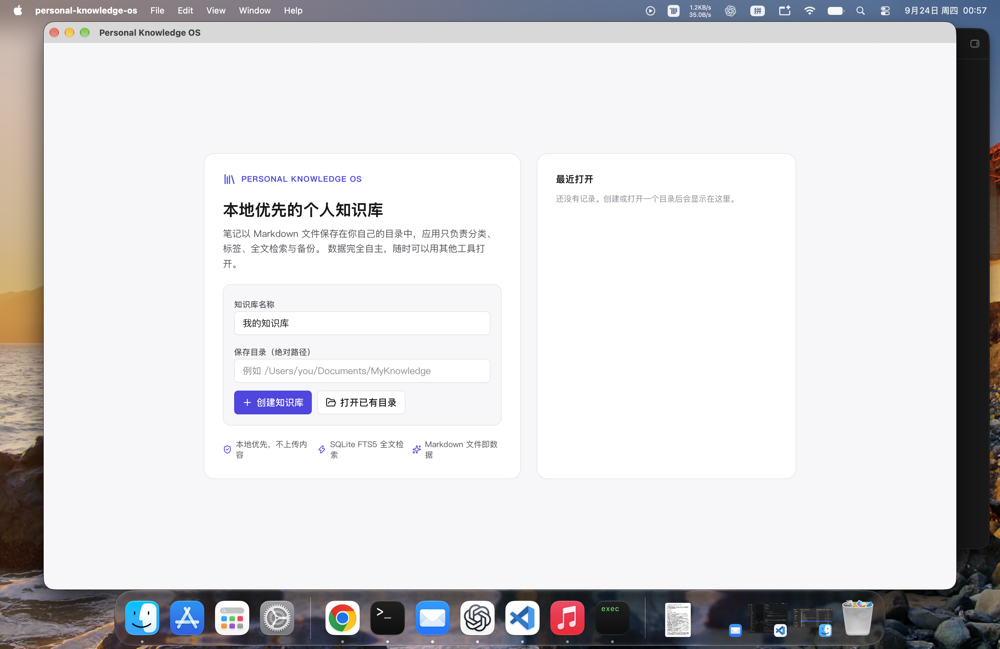
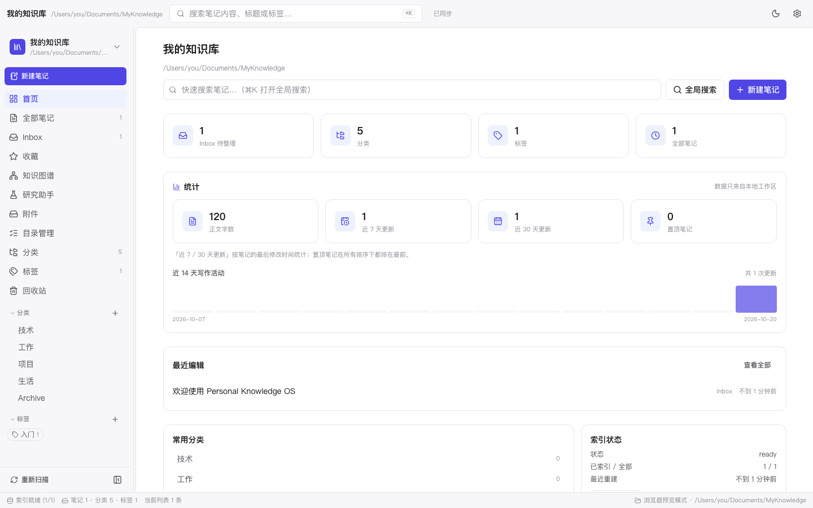
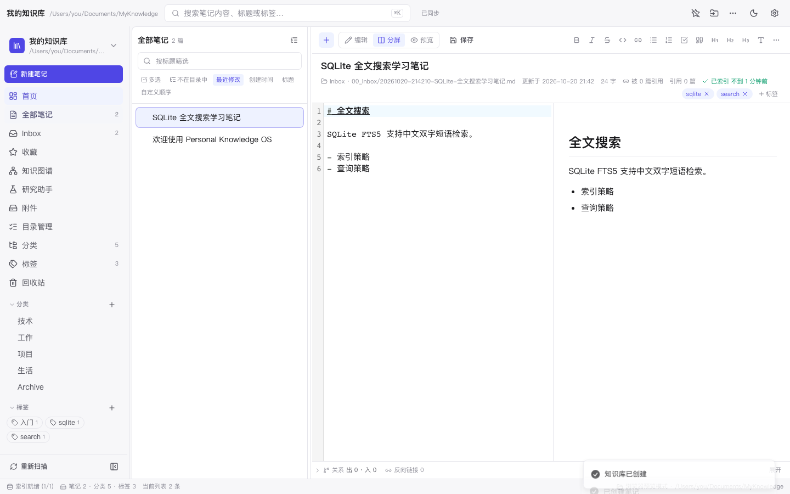
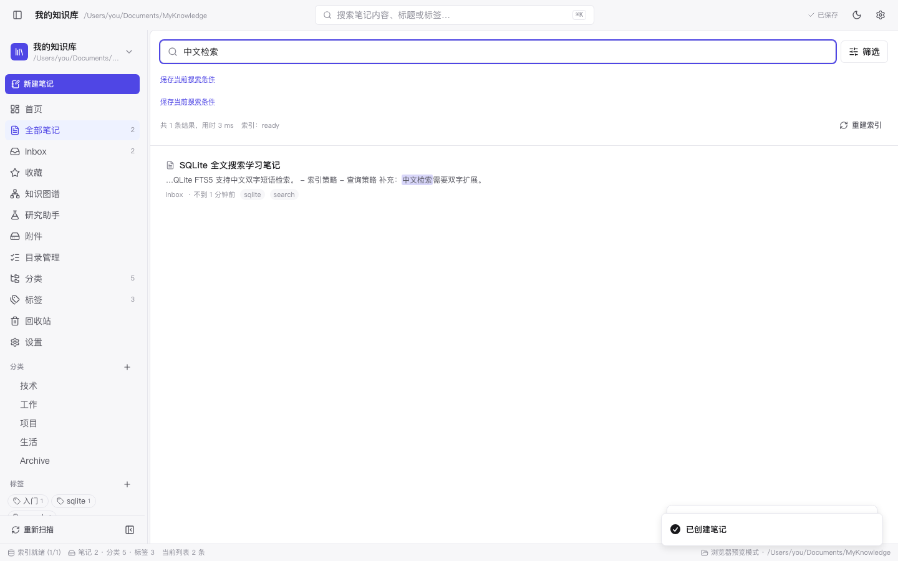
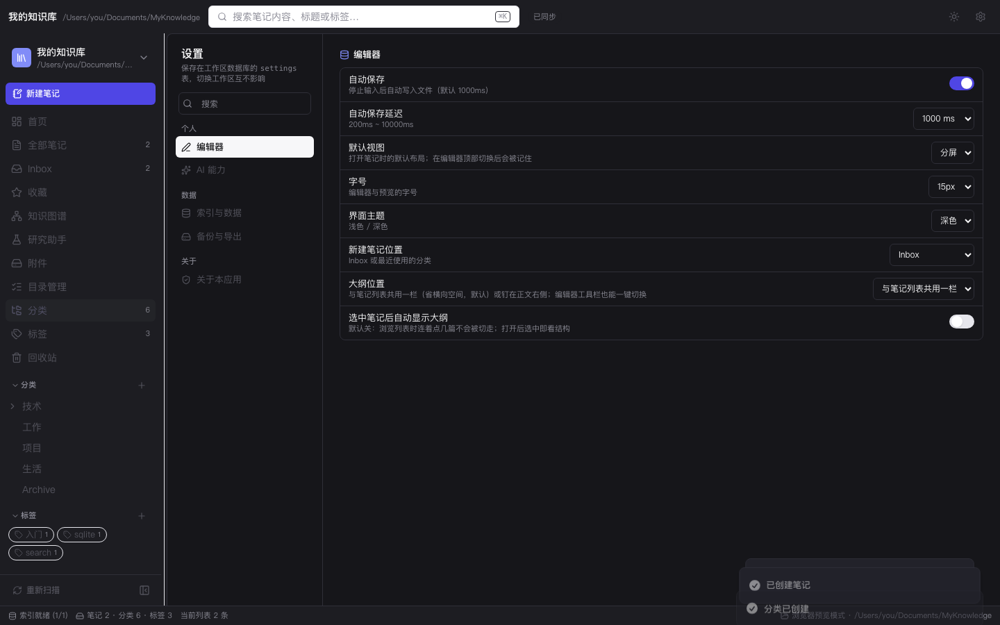

# Personal Knowledge OS

本地优先的个人知识管理桌面应用。笔记正文以 Markdown 文件保存在**你自己的目录**里，
SQLite 负责元数据与全文检索，界面基于 Tauri 2 + React 19 + TypeScript。
数据自主：删掉应用，笔记还在；删掉数据库，也能从 Markdown 重建。

**当前版本：V1.3.7**（2026-10-20 发布，四处版本号一致：`package.json` /
`src-tauri/Cargo.toml` / `Cargo.lock` / `src-tauri/tauri.conf.json`）。

- 📦 **[下载与安装](https://github.com/ResonLee-Code/personalknowlge/releases/tag/v1.3.7)**：三平台产物 + `SHA256SUMS-*.txt`
- 📘 **[完全指南（中文）](./docs/GUIDE.md)** · **[Complete Guide (English)](./docs/GUIDE.en.md)**
- 📗 **[使用说明手册（逐控件）](./docs/MANUAL.md)**：每个按钮 / 输入框 / 菜单项各是干什么的
- 🧾 变更明细 [docs/CHANGELOG.md](./docs/CHANGELOG.md) · 验收实况 [docs/ACCEPTANCE_V1.3.7.md](./docs/ACCEPTANCE_V1.3.7.md)

本仓库是 [Personal-Knowledge-OS-Engineering-Design-V1.0.md](./Personal-Knowledge-OS-Engineering-Design-V1.0.md)
工程设计的实现：先把**记录、分类、搜索**做扎实，再在其上长出**研究助手与决策层**——
所有 AI 能力默认关闭、可解释、可降级，不存在"悄悄联网"。

## 已实现能力

| 领域 | 能力 |
| --- | --- |
| 工作区 | 创建、打开（含就地初始化已有目录）、切换、关闭、最近列表、统计；窗口尺寸/位置记忆 |
| 笔记 | 新建（可选本地模板）、编辑、保存、自动保存、删除到回收站、恢复、永久删除、重命名（含文件名）、移动分类、复制、收藏、置顶 |
| 文档层级 | 子文档（拖拽成为子文档 / 同层排序，`parent` / `order` 写进 frontmatter）、大纲预览（默认与笔记列表共用一栏，可钉回正文右侧；钉在右侧时保持固定 / 贴边 / 隐藏三态） |
| 导入 | 外部 Markdown / 文本 / 目录导入（保留 frontmatter 的 id/标题/标签/时间，复制语义）；「保留目录结构」；内置 **Obsidian 库 / Notion 导出** 识别与转换；**Word(.docx) / CSV** 导入 |
| 附件 | 粘贴/拖入的图片落到 `attachments/YYYY-MM/`；`/attachments` 按月份清点、显示引用笔记、**「只看未引用」筛选**（引用判定口径见 [API 契约](./docs/API_CONTRACT.md)） |
| 导出 | 单篇 Markdown / HTML / Word(.docx)，PDF 走打印视图另存；整库导出 Markdown；ZIP 备份与逐项校验 |
| 布局 | 三栏可拖拽（双击复位、方向键微调），宽度随工作区记忆；编辑 / 分屏 / 预览，分屏比例可调；大纲默认与笔记列表**共用一栏**（宽屏可钉回正文右侧），位置随工作区记忆 |
| 分类与标签 | 分类树与子分类、重命名（同步目录与路径）、删除策略；多标签绑定、大小写不敏感唯一 |
| 搜索 | 标题 + 正文 + 标签全文检索（FTS5，中文双字 + 英文前缀）、相关度/时间排序、分类/标签/收藏/时间过滤、摘要高亮、索引状态与重建 |
| 检索通道化 | `bm25` 与可选的 `vector` 通道并行召回，**RRF 融合**并标注每路通道状态；单通道不可用不影响整次检索 |
| 向量检索（可选） | 在线嵌入（复用在线模型地址与 Key，模型名单独一项）+ **一次性确认**的增量构建；向量落 `.knowledge` 派生表，**可一键重建、不进备份** |
| 知识图谱 | `/graph`：节点 = 笔记、边 = 双向链接；分类着色、度数定大小、过滤、1–2 跳聚焦、缩放/平移/拖拽固定、双击打开 |
| 版本历史 | 保存前自动留档（60 秒节流、每篇 50 份）、任意两版对比、命名版本、还原正文 |
| 外部编辑 | 文件监听（原生事件 + 轮询兜底）、自动采纳外部新增/修改、标记缺失、忽略自身写入回声 |
| 网页剪藏 | 粘贴 URL → 抓取公开网页转 Markdown，写 `source_type: web` 与来源地址（非 UTF-8 页面按 Content-Type / `<meta charset>` / GBK 兜底解码） |
| 统计与复核 | 首页统计明细（字数 / 近 7·30 天更新 / 置顶数 / 近 14 天写作活跃度）+ **待复核卡片**（`valid_until` 已过期或 14 天内到期） |
| 研究助手 | `/research` 五步：立项 → 收集（本地 FTS5，可选联网检索）→ 验证（≥2 个独立来源才算交叉验证）→ 汇总（固定六段报告 + 置信度）→ 写入提案（默认 Inbox、同标题不覆盖、写前 diff、可回滚） |
| **证据充分性（N9）** | 收集计划会先做**查询扩展**（课题 → 括号短语 / 连接词切分 / 拉丁词，≤6 条，规则化、离线）；汇总前逐条判定证据够不够（覆盖 / 交叉验证 / 材料厚薄 / 来源强弱 / 时效），**不满足就明说「证据不足、本次不给结论」**，界面与报告三处同步显示 |
| **决策模型档（可选）** | 「设置 → AI → 决策模型」可在**规则档**与 **System One 档**（Perplexity Decisions / Jev 同协议，一份适配器覆盖两家）之间切换；Key 只写不读、独立授权；决策档排候选链最前，不可用自动降级到规则档 |
| **模型契约探针与校准评测** | 用**我们自己的中文题**跑出：准确率、自洽性（P(是)+P(否)）、两次一致性、矛盾判别、延迟、按输入 token 估的成本；**100 道可判分题**给出 ECE / Brier / 分箱 / 折外 ECE，以及规则档 vs 决策档的 **A/B 打分对比** |
| 决策层骨架 | 打分统一走决策引擎：内容寻址缓存（材料/模型配置一变即不命中）+ **可解释 Trace**（缓存命中、试过哪些档、为什么失败） |
| AI 闸门与隐私 | 总开关（默认关）+ 联网档位（默认「仅本地」+ 首次确认）+ 抓取正文（默认关）+ 域名黑白名单（黑名单强制）+ 研究预算；**逐次外发确认**可选；行为审计 `.knowledge/logs/ai-audit.jsonl`（**不含正文**） |
| 失败可见 | 「摘要 + 详情」：提示条给摘要与完整原因（停留 8 秒、可一键复制），就地失败（如保存失败徽标）可点开看完整原因 / 错误码 / 补充信息；同时写进应用日志 |
| 数据安全 | 原子写入、内容哈希冲突检测（外部改写会被拦下而不是被覆盖）、回收站、ZIP 备份与校验、路径穿越防护 |
| 平台 | macOS（`.app` + `.dmg`，**ad-hoc 签名**）、Windows（NSIS 安装包 + 便携版）、Linux（`deb` / `rpm` / `AppImage`）；推 `v*` 标签由 [release.yml](./.github/workflows/release.yml) 一次产出三平台工件并创建 Release |
| 工程守护 | `pnpm bench`（1 万检索 / 3 万图谱，超阈值即失败）、产物体积对照表 + 一键复现、真机验收脚本（AX 驱动界面，已实跑） |

## 技术栈

Tauri 2 · Rust · React 19 · TypeScript(strict) · Vite 8 · Tailwind CSS 4 · CodeMirror 6 ·
SQLite(bundled) + FTS5 · pulldown-cmark · notify · zip · serde · tracing ·
ureq(rustls) + dom_query（网页剪藏与联网检索，复用 tauri-utils 的 html5ever）

图谱视图为自研 Canvas 力导向布局（不引入可视化依赖）。向量检索用纯 Rust 暴力检索
（默认关闭、可一键重建）。AI 能力的边界与接口见 [docs/AI_ARCHITECTURE_PLAN.md](./docs/AI_ARCHITECTURE_PLAN.md)：
**默认不联网、不接模型**——联网是独立闸门（检索源由你自己配置，应用不预置第三方服务）；
本地模型（Ollama HTTP）与在线模型都要显式打开开关，失败自动降级到规则档 / 模板实现。

## 环境要求

- **Node.js ≥ 22.13**（pnpm 11 的硬要求）与 pnpm 11
- Rust ≥ 1.77（stable）与 C 编译器（构建 bundled SQLite）
- macOS 或 Windows 的桌面环境（Linux 需 WebKitGTK 4.1，见安装指南）

> 如果网络无法访问 `index.crates.io`，本项目 `.cargo/config.toml` 已把 crates.io 指向可达镜像；
> 详见 [docs/DEVELOPMENT_RULES.md](./docs/DEVELOPMENT_RULES.md)。

## 常用命令

```bash
pnpm install                 # 安装前端依赖
pnpm dev                     # 浏览器预览（内置内存后端，无需 Tauri）
pnpm tauri dev               # 启动桌面应用（开发模式）
pnpm build                   # 前端类型检查 + 生产构建
pnpm test                    # 前端单元测试（Vitest，含文档链接守卫）
pnpm test:e2e                # 端到端 UI 验证（Playwright + 内存后端，产出 docs/screenshots）
pnpm lint                    # ESLint
pnpm bench                   # 发布前性能守护：1 万检索 + 3 万图谱，超阈值即失败

cd src-tauri
cargo test                   # Rust 单元测试 + 集成测试（47 个测试目标）
cargo build                  # 构建桌面二进制
```

出包、真机验收与体积对照：`pnpm tauri build --bundles app dmg`、`scripts/acceptance/run.sh`（AX 驱动界面）、
`scripts/size-report.sh`（体积表）——完整清单见 [docs/BUILD_COMMANDS.md](./docs/BUILD_COMMANDS.md)。

## 界面预览

桌面应用（Tauri 外壳，真实 SQLite 后端）：



| 首页 | 编辑器（分屏） |
| --- | --- |
|  |  |

| 搜索结果与高亮 | 深色主题 |
| --- | --- |
|  |  |

其余截图（欢迎页、全局搜索面板、分类管理、标签、设置、笔记列表、研究助手…）位于
[`docs/screenshots/`](./docs/screenshots)，由 `pnpm test:e2e` 自动生成。

## 下载与安装

从 **[v1.3.7 Release](https://github.com/ResonLee-Code/personalknowlge/releases/tag/v1.3.7)** 下载；
每个平台另附 `SHA256SUMS-<platform>.txt`，在下载目录里直接校验：

```bash
shasum -a 256 -c SHA256SUMS-all.txt     # Linux 用 sha256sum -c
```

| 平台 | 产物 | 说明 |
| --- | --- | --- |
| macOS（arm64） | `Personal.Knowledge.OS_1.3.7_aarch64.dmg` | **ad-hoc 签名**（无 Developer ID、无公证）：首次打开会提示「无法验证开发者」，到 系统设置 → 隐私与安全性 →「**仍要打开**」放行一次即可。若看到「**已损坏**」说明该版没走 ad-hoc 签名（本版不会） |
| Windows（x64） | `…_x64-setup.exe`（NSIS）/ `…_x64-portable.zip` | 未签名：SmartScreen 提示后选「更多信息 → 仍要运行」；安装包外壳是 32 位 stub 属正常 |
| Linux（x64） | `…_amd64.deb` / `…-1.x86_64.rpm` / `…_amd64.AppImage` | 需 WebKitGTK 4.1；AppImage 需 `chmod +x` |

平台细节、静默安装、卸载与排错见 [Windows](./docs/WINDOWS_INSTALL_GUIDE.md) ·
[Linux](./docs/LINUX_INSTALL_GUIDE.md)；本机从源码出包见 [BUILD_COMMANDS.md](./docs/BUILD_COMMANDS.md)。

## 目录结构

```text
.
├── Personal-Knowledge-OS-Engineering-Design-V1.0.md   # 工程设计基线
├── docs/                                              # 指南 / 架构 / 数据库 / API / UI / 规范 / 路线
├── src/                                               # 前端（app, components, features, stores, services, lib）
├── src-tauri/                                         # Rust 后端（commands, application, domain, infrastructure, repositories）
└── scripts/                                           # 验收 / 基准 / 体积 / 交叉编译 / 图标
```

## 数据布局

工作区目录（可在「创建知识库」时选择；**删掉应用不会动它**）：

```text
MyKnowledge/
├── .knowledge/
│   ├── database.sqlite      # 元数据 + FTS5 索引 + 设置 + 决策缓存 + chunk 向量（派生）
│   ├── config.json          # 工作区配置（版本、路径、目录约定）
│   ├── backups/             # 备份包
│   ├── templates/           # 「另存为模板」的本地模板
│   ├── history/<笔记 id>/    # 版本历史快照（命名版本存 labels.json）
│   ├── research/            # 研究助手会话（可丢弃的中间产物）
│   ├── logs/app.log         # 运行日志（失败原因与界面提示同一份）
│   ├── logs/ai-audit.jsonl  # AI 行为审计（时间/能力/是否外发/结果，不含正文）
│   └── index/               # 预留索引目录
├── .trash/                  # 回收站（保留原相对路径）
├── 00_Inbox/ 01_技术/ … 99_Archive/
└── attachments/
```

数据库是**派生数据**：删掉后可从 Markdown 全量重建（设置与版本历史也会随备份恢复）。
向量与决策缓存同理，可一键重建、不进备份。

## 文档

**先读这三份**：[完全指南（中文）](./docs/GUIDE.md) · [Complete Guide (English)](./docs/GUIDE.en.md) ·
[使用说明手册（逐控件）](./docs/MANUAL.md)

- [产品需求](./docs/PRODUCT_REQUIREMENTS.md) · [系统架构](./docs/ARCHITECTURE.md) · [数据库设计](./docs/DATABASE_SCHEMA.md)
- [API 契约](./docs/API_CONTRACT.md) · [界面规范](./docs/UI_SPECIFICATION.md) · [开发规范](./docs/DEVELOPMENT_RULES.md)
- [构建命令速查（只编译 / 出安装包 / 发版）](./docs/BUILD_COMMANDS.md) · [发版流程](./docs/RELEASE_PROCESS.md) · [产物体积对照表](./docs/ARTIFACT_SIZES.md)
- [开发路线](./docs/ROADMAP.md) · [功能规划（对标语雀/飞书 + 知识图谱）](./docs/FEATURE_PLANNING.md) · [语雀官方手册归档](./docs/yuque-manuals/README.md)
- [变更记录](./docs/CHANGELOG.md) · [V1.3.0 验收记录](./docs/ACCEPTANCE_V1.3.0.md) · [V1.2.1 验收清单](./docs/ACCEPTANCE_V1.2.1.md) · [V1.2.0 产物验收](./docs/ACCEPTANCE_V1.2.0.md)
- [AI 能力框架（闸门 / 工具层 / 研究助手规格）](./docs/AI_ARCHITECTURE_PLAN.md) · [下一代技术储备与差距分析](./docs/NEXT_GEN_ANALYSIS.md)
- [阶段计划：V1.3.0（当前）](./docs/PLAN_V1.3.0.md) · [V1.2.1（历史）](./docs/PLAN_V1.2.1.md) · [V1.1（历史）](./docs/PLAN_V1.1.md)
